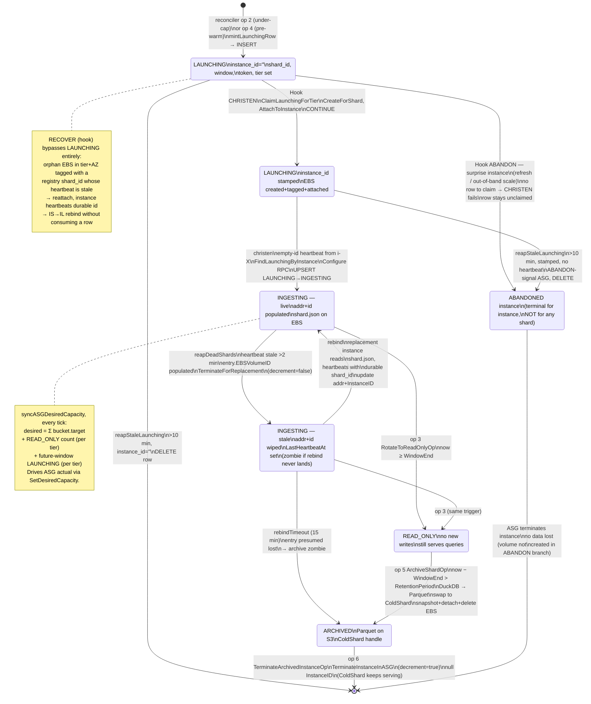
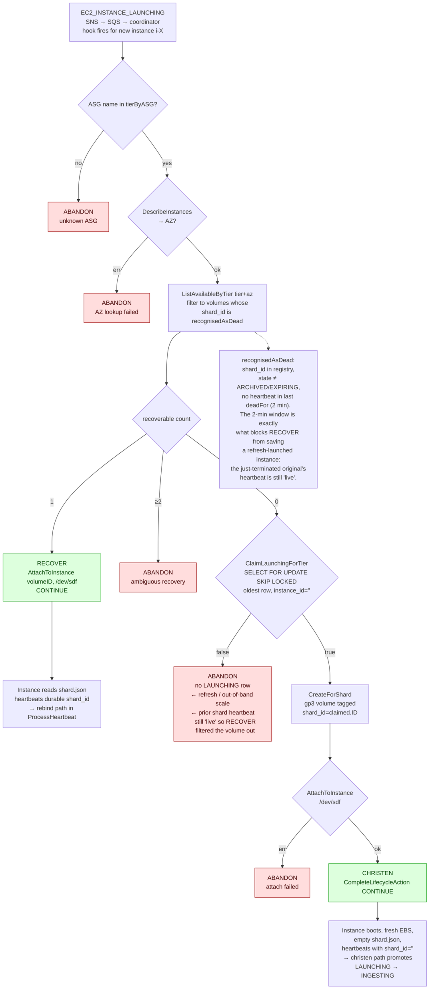

# Shard lifecycle — comprehensive flowcharts

Companion to [`v1.md`](v1.md). Three diagrams covering the launch / live /
wind-down loop:

1. **Shard state machine** — every state a shard row can occupy and
   the transitions between them.
2. **Lifecycle hook decision tree** — what the SQS-driven hook does
   when a new ASG instance hits `Pending:Wait`. This is where the
   orphan-christen ABANDON branch lives.
3. **Reconciler tick** — the order of work each `PollInterval`.

`StateExpiring` is defined in `coordinator/registry.go:22` but no
transition writes it. Treat it as a ghost.

---

## 1. Shard state machine



---

## 2. Lifecycle hook decision tree

Where v1.md's bug lives — the `ABANDON: no LAUNCHING row` path is
hit any time AWS launches an instance the reconciler didn't pre-mint
a row for (instance refresh, manual scale, ASG self-healing during
the 2-min `recognisedAsDead` blackout window).



---

## 3. One reconciler tick

```mermaid
flowchart TD
    Tick[ticker fires<br/>PollInterval = 5 min prod / 5 s dev]
    Tick --> AH[adoptFromHeartbeats<br/>LiveShardHeartbeats 2 min<br/>→ ProcessHeartbeat each:<br/>christen / rebind / unsuspend / adopt]
    AH --> RD[reapDeadShards<br/>for each registry entry not in heartbeats:<br/>EBS-bound → TerminateForReplacement,<br/>wipe addr+id, await rebind<br/>or 15 min timeout → archive<br/>else → Remove + TerminateInstance]
    RD --> RL[reapStaleLaunching<br/>>10 min old:<br/>id='' → DELETE<br/>id set, no HB → ABANDON+DELETE]
    RL --> Check[check — per-bucket loop]
    Check --> Snap[snapshotForBucket<br/>Entries from registry,<br/>LaunchingCount/FutureLaunching from DB,<br/>IngestingCount derived from registry walk<br/>← orphan-christen fix lives here]
    Snap --> Reconcile[reconcile snap → ordered ops]

    Reconcile --> O1[op 1 AddAppToShardOp<br/>app drift — bucket.Apps not on shard]
    O1 --> O3[op 3 RotateToReadOnlyOp<br/>INGESTING past WindowEnd]
    O3 --> O2[op 2 LaunchShardOp<br/>for i := effective; i&lt;target<br/>where effective = LaunchingCount<br/>+ registry-walked INGESTING<br/>→ provisionForBucket → mintLaunchingRow]
    O2 --> O4[op 4 PrewarmNextWindowOp<br/>WindowEnd − now ≤ PrewarmLead<br/>and FutureLaunching=0<br/>→ Target × mintLaunchingRowForWindow]
    O4 --> O5[op 5 ArchiveShardOp<br/>READ_ONLY past RetentionPeriod<br/>→ Parquet export, ColdShard,<br/>retire EBS volume]
    O5 --> O6[op 6 TerminateArchivedInstanceOp<br/>ARCHIVED w/ instance_id<br/>→ TerminateInstanceInASG<br/>(decrement=true)]

    O6 --> Sync[syncASGDesiredCapacity<br/>per tier:<br/>desired = Σ bucket.target<br/>          + count READ_ONLY<br/>          + count future-window LAUNCHING<br/>clamp to MaxSize, log if clamped<br/>SetDesiredCapacity tier, desired]
    Sync --> Done[next tick]

    classDef bug fill:#ffd,stroke:#a80,color:#640
    class Snap,O2 bug
```

The two yellow-tinted boxes in (3) are where the v1.md story plays
out: `Snap` is the post-fix DB-cache walk (used to inflate
`IngestingCount` with zombie DB rows pre-fix; now correct); `O2` is
what *should* mint a recovery LAUNCHING row when an instance refresh
kills a shard, but doesn't — because `IngestingCount` stays at target
until the 15-min `rebindTimeout` flushes the stale entry to
ARCHIVED.
